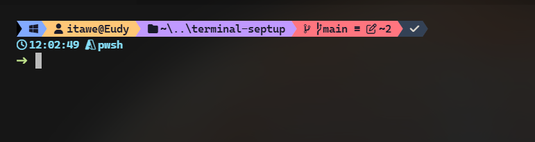
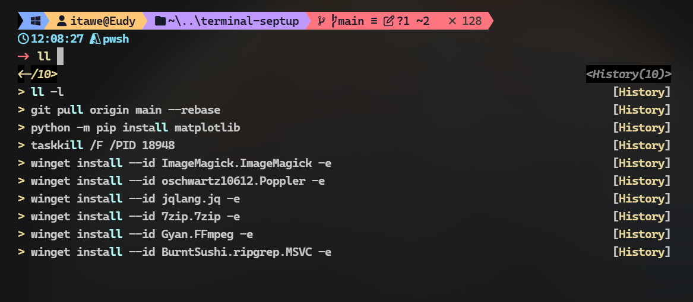
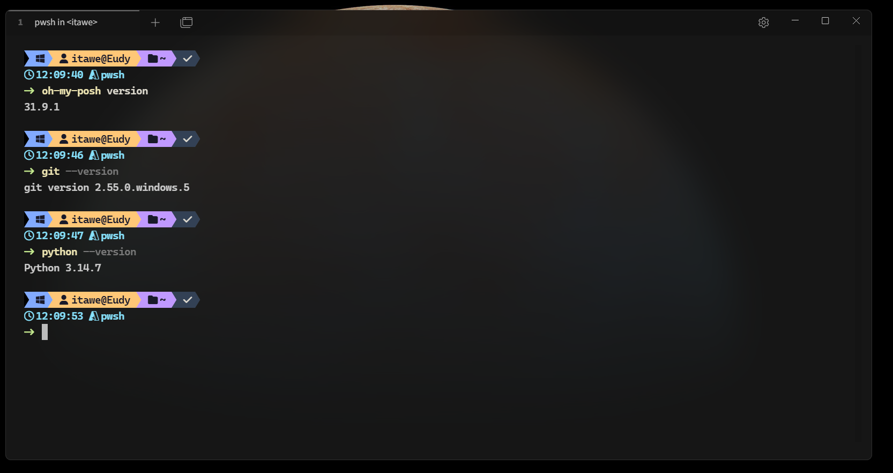
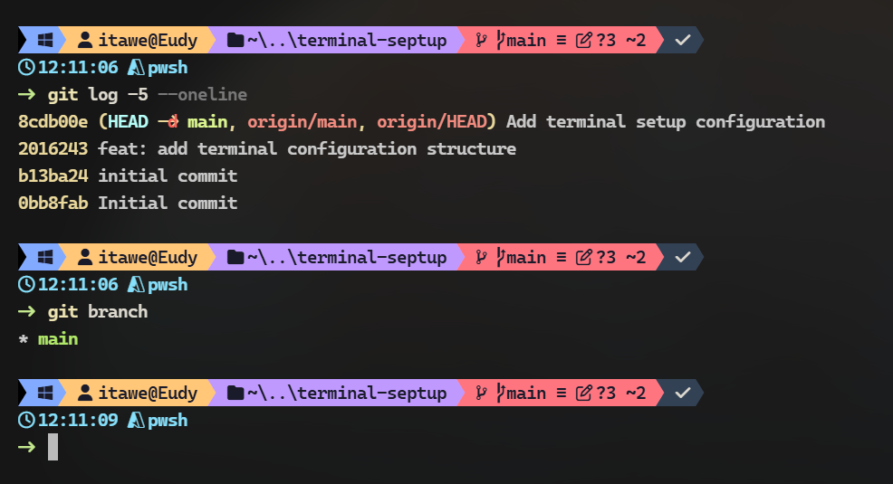

# Mi entorno de terminal en Windows

Configuración personal de PowerShell 7, Tabby y Windows Terminal. Incluye el perfil, el tema Eclipse de Oh My Posh, ajustes de fuentes y una galería de capturas.

## Capturas

### Prompt PowerShell con Oh My Posh

### Sugerencias de PSReadLine

### PowerShell y herramientas

### Git en el prompt

## Módulos, paquetes y utilidades

### Módulos de PowerShell

| Módulo | Para qué lo uso |
| --- | --- |
| `PSReadLine` | Edición interactiva, autocompletado, sugerencias del historial y búsqueda de comandos anteriores. |
| `Terminal-Icons` | Muestra iconos junto a archivos y carpetas en PowerShell. |

### Herramientas del perfil

| Herramienta | Función |
| --- | --- |
| [Oh My Posh](oh-my-posh/README.md) | Dibuja el prompt con el tema Eclipse: usuario, carpeta, estado de Git, hora y resultado del último comando. |
| `zoxide` | Navega a carpetas visitadas con el comando `z`. |
| `eza` | Reemplaza los listados básicos con iconos, detalles, estado Git y vista de árbol. |
| `bat` | Muestra archivos con resaltado de sintaxis; el alias `cat` lo ejecuta sin paginador. |
| `Git` | Control de versiones; el perfil ofrece atajos para estado, staging, commits, ramas, historial y push. |
| `Yazi` | Administrador de archivos en la terminal para explorar carpetas y gestionar archivos. Se instala aparte; esta versión del repositorio todavía no incluye su configuración propia. |

### Otras utilidades que aparecen en las capturas

| Paquete | Uso |
| --- | --- |
| `Python` + `matplotlib` | Ejecutar Python e instalar la biblioteca para crear gráficos. |
| `ImageMagick` | Convertir, crear y procesar imágenes desde la línea de comandos. |
| `Poppler` | Herramientas de línea de comandos para consultar, convertir y renderizar PDF. |
| `jq` | Consultar y transformar datos JSON desde la terminal. |
| `7-Zip` | Comprimir y extraer archivos. |
| `FFmpeg` | Procesar audio y video. |
| `ripgrep` (`rg`) | Buscar texto rápidamente dentro de archivos y carpetas. |

Las capturas muestran como referencia Oh My Posh `31.9.1`, Git `2.55.0.windows.5` y Python `3.14.7` en la fecha en que se tomaron. Las versiones pueden cambiar.

## Funciones y atajos de PowerShell

El perfil completo está en [`powershell/Microsoft.PowerShell_profile.ps1`](powershell/Microsoft.PowerShell_profile.ps1).

| Comando | Qué hace |
| --- | --- |
| `ls` | Lista archivos con `eza` e iconos. |
| `ll` | Lista también elementos ocultos con detalles, iconos y estado Git. |
| `la` | Incluye elementos ocultos en el listado. |
| `lt` | Muestra un árbol de carpetas hasta dos niveles. |
| `cat` | Muestra archivos con `bat` sin abrir paginador. |
| `..` / `...` / `....` | Sube uno, dos o tres niveles de carpetas. |
| `gs` | Muestra el estado de Git. |
| `ga <archivos>` | Añade los archivos indicados al staging. |
| `gaa` | Añade todos los cambios de la carpeta actual al staging. |
| `gc <opciones>` | Crea un commit; pasa las opciones de `git commit`, por ejemplo `gc -m "mensaje"`. |
| `gp` | Envía los commits con `git push`. |
| `gl` | Muestra el historial como gráfico, con ramas y referencias. |
| `gb` | Lista o administra ramas; acepta los argumentos de `git branch`. |
| `gco <rama>` | Cambia de rama o revisión con `git checkout`. |
| `z <carpeta>` | Salta a una carpeta conocida por zoxide. |

PSReadLine está configurado en modo Windows, conserva el historial sin duplicados, muestra sugerencias en lista y usa `Tab` para el menú de autocompletado. Las flechas arriba/abajo buscan en el historial según lo que ya se haya escrito.

## Ajustes de terminal

### Tabby

La exportación está en [`tabbyconfig/config.yaml`](tabbyconfig/config.yaml):

- Perfil de inicio: PowerShell Core; fuente `CaskaydiaCove NF`, 16 px, peso 500 y ligaduras activadas.
- Esquema oscuro integrado `Tabby Default`; cursor de bloque parpadeante.
- Renderizado WebGL, historial de 25 000 líneas, copia al seleccionar y clic derecho para pegar.
- Ventanas divididas: `Ctrl+Shift+S` a la derecha y `Ctrl+Shift+D` abajo; pestaña nueva `Ctrl+Shift+T`.
- La exportación no contiene perfiles SSH, perfiles personalizados ni secretos de bóveda.

### Windows Terminal

La copia de ajustes está en [`windows-terminal/settings.json`](windows-terminal/settings.json):

- PowerShell 7 es el perfil predeterminado, con esquema `Dark+` y opacidad del 90 %.
- Fuente `Monaspace Neon NF`, tamaño 12, para PowerShell; `Monaspace Argon NF SemiBold` como fuente predeterminada.
- Ligaduras activadas, incluyendo las variantes estilísticas de Monaspace.
- Atajos personalizados para copiar, pegar y duplicar un panel.

### Fuentes

Las fuentes no se incluyen como binarios. Consulta [`fonts/README.md`](fonts/README.md) para los nombres exactos que debes instalar.

## Instalación

1. Instala PowerShell 7, Tabby, Windows Terminal, Oh My Posh, Terminal-Icons, PSReadLine, zoxide, eza, bat, Git y Yazi.
2. Instala las fuentes indicadas en [`fonts/README.md`](fonts/README.md).
3. Desde la raíz del repositorio, ejecuta `./scripts/install.ps1`. El script respalda los archivos existentes y copia el perfil y el tema Eclipse.
4. Restaura Tabby y Windows Terminal siguiendo [`tabbyconfig/README.md`](tabbyconfig/README.md) y [`windows-terminal/README.md`](windows-terminal/README.md).
